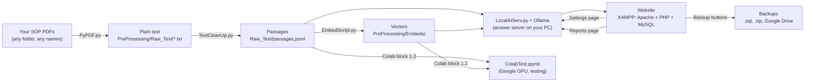

# Getting started

This guide takes you from a folder of your own SOP documents to a working website where people log in and ask questions about them. The assistant finds the passages that answer the question and has a small AI model (Qwen) write an answer that cites them. Admins can also change the assistant's settings, generate usage reports and make backups from the website.

Work through the documents in order. Each one ends with a check, so you know a step worked before you move on.

| Step | Document | What you end up with |
|---|---|---|
| 1 | [Install the software](1-Install-Software.md) | Python (with a `.venv`), Ollama, XAMPP and Composer installed |
| 2 | [Prepare your SOPs](2-Prepare-Your-SOPs.md) | Your organisation's name set, and your SOPs turned into clean, searchable passages |
| 3 | [Embed your SOPs](3-Embed-Your-SOPs.md) | Vectors that let the assistant search your SOPs by meaning |
| 4 | [Answer questions: on your PC or Google Colab](4-Choose-Local-or-Colab.md) | The answer server running and answering questions about your SOPs |
| 5 | [Set up the website](5-Set-Up-the-Website.md) | The login page, question pages, settings, reports and backups running |
| 6 | [Troubleshooting](6-Troubleshooting.md) | Fixes for the errors people run into most |

## How the pieces fit together



Steps 2 and 3 prepare your documents. You only repeat them when your SOPs change. When someone asks a question on the website:

1. The question page (`Agent.php`, or `adminAgent.php` for admins) saves it in MySQL.
2. It sends the question to `LocalAIServ.py`, the answer server running on the same PC.
3. The answer server queues the question (admins' questions go first), finds the passages closest in meaning to it, and has Qwen answer using only those passages.
4. The answer and its sources appear on the page and are saved in MySQL. The person can rate the answer.

The answer server does more than answer questions. The website also asks it for the **report PDFs**, the **Google Drive and system backups**, and to **read and change the settings** in `config.json`.

## Where things live

```
LLM/
├── GettingStarted/          ← this guide
├── config.json              ← organisation name, model and answer settings, backup folder (the Settings page edits it)
├── requirements.txt         ← the Python packages the scripts need
├── .venv/                   ← your Python environment (made in step 1; the website's Start server button needs it)
├── PreProcessing/
│   ├── PyPDF.py             ← 1. copies the text out of your SOP PDFs
│   ├── TextCleanUp.py       ← 2. cleans the text and splits it into passages
│   ├── Raw_Text/            ←    text files and passages.jsonl end up here
│   ├── Embeds/              ← 3. EmbedScript.py saves the vectors here
│   ├── PreProcessesV1/      ←    passages and vectors for SAHPRA's guidelines (demo, used by Colab block 1.1)
│   └── DownloadAll.py       ←    only for downloading SAHPRA's public guidelines
├── EmbedScript.py           ← turns passages into vectors
├── LocalAIServ.py           ← the answer server the website talks to
├── APIS/                    ← the answer server's routes: reports, backups and settings
├── ReportGeneration/        ← GenerateReport.py, which makes the report PDFs (saved in Reports/)
├── Backup/                  ← ScheduleBackup.py, the source of ScheduleBackup.exe
├── ScheduleBackup.exe       ← optional, built by you (step 5.8): the local database backup and Task Scheduler backups
├── ColabTest.ipynb          ← answers questions on Google Colab
└── FrontEnd/                ← the website (copied into XAMPP)
    ├── common/, js/         ← helpers and scripts the pages share
    ├── Agent/, adminAgent/, reports/, settings/, ...   ← the functions each page runs (the pages hold their own HTML and CSS)
    └── FrontEndConfig.json  ← your MySQL login, starting accounts and allowed email domains (you make it in step 5.2)
```

The scripts find `config.json`, `Raw_Text`, `Embeds` and `FrontEndConfig.json` relative to their own folder, so keep the folder layout as shown.

## Before you start: keep your SOPs and passwords private

Your SOP documents and the files made from them (`Raw_Text/`, `Embeds/`, `PreProcessesV1/`) contain your SOP text. Don't commit them to a public GitHub repository. `FrontEnd/FrontEndConfig.json` holds your MySQL password and the starting account passwords (step 5.2), and a Google sign in uses `client_secret*.json` and `GoogleDrive/` (step 5.8). The project's `.gitignore` already keeps these out of git; keep it that way. The **system backup** zips the project folder, so it also contains these files: keep those zips private too. If you use Google Colab, your passages are processed on Google's servers; check that your organisation allows this.
