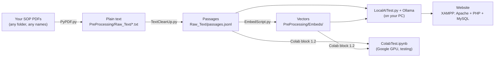

# Getting started

This guide takes you from a folder of your own SOP documents to a working website where people log in and ask questions about them. The assistant finds the passages that answer the question and has a small AI model (Qwen) write an answer that cites them.

Work through the documents in order. Each one ends with a check, so you know a step worked before you move on.

| Step | Document | What you end up with |
|---|---|---|
| 1 | [Install the software](1-Install-Software.md) | Python and its packages, Ollama, XAMPP and Composer installed |
| 2 | [Prepare your SOPs](2-Prepare-Your-SOPs.md) | Your organisation's name set, and your SOPs turned into clean, searchable passages |
| 3 | [Embed your SOPs](3-Embed-Your-SOPs.md) | Vectors that let the assistant search your SOPs by meaning |
| 4 | [Answer questions: on your PC or Google Colab](4-Choose-Local-or-Colab.md) | The AI model answering questions about your SOPs |
| 5 | [Set up the website](5-Set-Up-the-Website.md) | The login page and question page running |
| 6 | [Troubleshooting](6-Troubleshooting.md) | Fixes for the errors people run into most |

## How the pieces fit together



Steps 2 and 3 prepare your documents. You only repeat them when your SOPs change. When someone asks a question on the website:

1. The question page (`Agent.php`, or `adminAgent.php` for admins) saves it in MySQL.
2. It runs `LocalAITest.py`, which finds the passages closest in meaning to the question.
3. Qwen answers using only those passages.
4. The answer and its sources appear on the page and are saved in MySQL.

## Where things live

```
LLM/
├── GettingStarted/          ← this guide
├── config.json              ← your organisation's name (ORG_NAME) and the last SOP folder you chose
├── PreProcessing/
│   ├── PyPDF.py             ← 1. copies the text out of your SOP PDFs
│   ├── TextCleanUp.py       ← 2. cleans the text and splits it into passages
│   ├── Raw_Text/            ←    text files and passages.jsonl end up here
│   ├── Embeds/              ← 3. EmbedScript.py saves the vectors here
│   ├── PreProcessesV1/      ←    passages and vectors for SAHPRA's guidelines (demo, used by Colab block 1.1)
│   ├── Guidelines/          ←    SAHPRA's public guidelines (demo documents)
│   └── DownloadAll.py       ←    only for downloading SAHPRA's public guidelines
├── EmbedScript.py           ← turns passages into vectors
├── LocalAITest.py           ← answers a question on your PC (the website uses this)
├── ColabTest.ipynb          ← answers questions on Google Colab
└── FrontEnd/                ← the website (copied into XAMPP)
    └── passwords.txt        ← your MySQL login and Python paths for the website
```

`LocalAITest.py` reads your passages from `Raw_Text` and your vectors from `Embeds`. `PreProcessesV1` holds a ready-made set for SAHPRA's guidelines, which Colab block 1.1 can use as a demo.

## Before you start: keep your SOPs and passwords private

Your SOP documents and the files made from them (`Raw_Text/`, `Embeds/`, `PreProcessesV1/`) contain your SOP text. Don't commit them to a public GitHub repository. `FrontEnd/passwords.txt` holds your MySQL password (step 5). The project's `.gitignore` already keeps it out of git; keep it that way. If you use Google Colab, your passages are processed on Google's servers; check that your organisation allows this.
