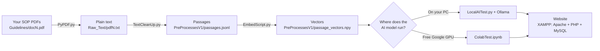

# Getting started

This guide takes you from a folder of your own SOP documents to a working website where people log in and ask questions about them. The assistant finds the passages that answer the question and has a small AI model (Qwen) write an answer that cites them.

Work through the documents in order. Each one ends with a check, so you know a step worked before you move on.

| Step | Document | What you end up with |
|---|---|---|
| 1 | [Install the software](1-Install-Software.md) | Python, Ollama, XAMPP and Composer installed; you can run a Python file |
| 2 | [Prepare your SOPs](2-Prepare-Your-SOPs.md) | Your SOPs as clean, searchable passages, and an understanding of what the clean-up script can and can't handle |
| 3 | [Embed your SOPs](3-Embed-Your-SOPs.md) | A vector file that lets the assistant search your SOPs by meaning |
| 4 | [Choose local or Google Colab](4-Choose-Local-or-Colab.md) | The AI model answering questions, either on your PC or on a free Google GPU |
| 5 | [Set up the website](5-Set-Up-the-Website.md) | The login page and chat page running, with your details in `passwords.txt` |
| 6 | [Troubleshooting](6-Troubleshooting.md) | Fixes for the errors people run into most |

## How the pieces fit together



Steps 2 and 3 prepare your documents once; you only repeat them when your SOPs change. Steps 4 and 5 are what runs every time someone asks a question:

1. The person types a question on the website.
2. `dataconn.php` saves the question in MySQL.
3. It sends the question to Colab, or to `LocalAITest.py` on your PC.
4. That finds the 3–5 passages closest in meaning and asks Qwen to answer using only those passages.
5. The answer and its sources come back to the page and are saved in MySQL.

## Where things live

```
LLM/
├── GettingStarted/                 ← this guide
├── PreProcessingSAHPRAGuidelines/
│   ├── Guidelines/                 ← 1. put your SOP PDFs here (doc1.pdf, doc2.pdf, …)
│   ├── Raw_Text/                   ← 2. PyPDF.py writes plain text here
│   ├── PreProcessesV1/             ← 3. TextCleanUp.py and EmbedScript.py write here
│   ├── PyPDF.py                    ← converts PDFs to text
│   ├── TextCleanUp.py              ← cleans text and splits it into passages
│   └── DownloadAll.py              ← only for downloading SAHPRA's public guidelines
├── EmbedScript.py                  ← turns passages into vectors
├── LocalAITest.py                  ← answers a question on your PC
├── ColabTest.ipynb                 ← answers questions on Google Colab
└── FrontEnd/                       ← the website (copied into XAMPP)
    └── passwords.txt               ← your database login, accounts and Colab address
```

The folder is still called `PreProcessingSAHPRAGuidelines` because the project started with SAHPRA's public guidelines. Your own SOPs go through exactly the same folders.

## Before you start: keep your SOPs private

Your SOP documents and the files made from them (`Raw_Text/`, `PreProcessesV1/`) contain your SOP text. Don't commit them to a public GitHub repository. If you use Google Colab, the text is processed on Google's servers; check that your organisation allows this before choosing Colab in step 4.
